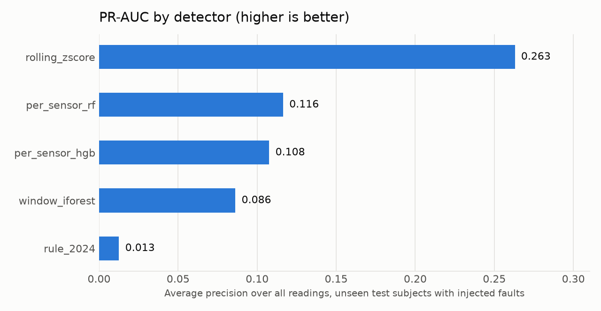
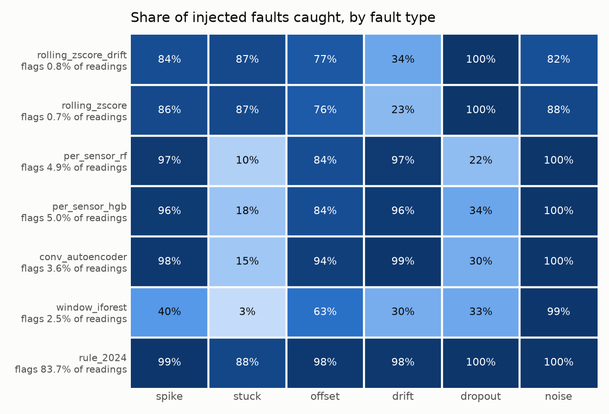

# Anomaly Detection in Wearable Sensor Data

Detects faulty readings (spikes, frozen sensors, offsets, drifts, dropouts, noise bursts) in 100 Hz
wearable sensor data from the PAMAP2 dataset, live, on people the models never saw.

**Live demo:** https://anomaly-detection-in-wearable-senso.vercel.app
**API:** https://wearable-anomaly-api.onrender.com ([interactive docs](https://wearable-anomaly-api.onrender.com/docs))
(free hosting: the first request after ~15 idle minutes takes 30-60 s while the API wakes up)

| Served detector (rolling z-score + drift signal), unseen test subjects | Value |
|---|---|
| F1 / PR-AUC on 1,860 injected faults | **0.381 / 0.375** (best of 6 detectors; the 2024 method scores 0.024 / 0.013) |
| False alarms on clean unseen data | **0.58%** (target 0.5%, set on a separate calibration subject) |
| Faults caught in the live demo (event level) | **50 / 64 (78%)** at 1.03% false-alarm readings |
| Stream latency, batch complete to client (local, p50 / p95) | **12.3 ms / 17.0 ms** |
| Served model size | **4.4 KB** of JSON (the 2024 version: 52 pickles, ~560 MB) |

---

## How it works

```
 PAMAP2 .dat files (9 subjects, 2.87M rows, 100 Hz)
        │  data.py         load + assert official row counts (a truncated file fails loudly)
        ▼
 preprocess.py             drop transient activity 0, invalid orientation + duplicate ±6g channels
                           → 31 sensors; carry heart rate forward per subject; split BY PERSON
        │
        ├──► faults.py     inject labelled faults: spike, stuck, offset, drift, dropout, noise
        ▼
 detectors/                same interface: fit → calibrate (unseen subject) → score (>1 = anomaly)
   rolling_zscore(_drift) · per_sensor_rf · per_sensor_hgb · window_iforest · conv_autoencoder
        │
        ├──► benchmark.py  every detector scores the same injected faults → reports/
        ▼
 export.py                 served model → api/model/rolling_zscore_drift.json (4.4 KB)
        │
 api/ (FastAPI, Docker, Render)            web/ (Next.js, uPlot, Vercel)
   GET  /health                              /           live stream: flags vs real faults
   POST /detect     (.dat / .csv upload) ◄── /upload     upload a recording
   WS   /ws/stream  (100 Hz replay)      ◄── /benchmark  detector comparison
```

### Why these choices

- **Split by person, never by row.** Rows 0.01 s apart are near-copies; a random split puts the same moment in
  train and test. Train on 5 subjects, set thresholds on a 6th, report on 2 more nobody touched.
- **Inject faults to get ground truth.** PAMAP2 has no labelled anomalies, so 2024 had no way to measure
  detection at all. Six fault types sized in each sensor's training standard deviation give precision, recall
  and PR-AUC, broken down by fault type.
- **Thresholds from a false-alarm budget.** Each sensor's threshold is the quantile that would flag 0.5% of a
  clean, unseen subject. That turns "how sensitive?" into a number chosen up front instead of "10% of the value".
- **Serve the simplest detector that wins.** The rolling z-score beat every learned model, is causal (works on a
  live stream) and is a few KB of JSON: readable, diffable, no pickle to unpickle. Its weakness, slow drifts, was
  fixed with one more signal (the level vs. a baseline from 5-15 s ago), not a bigger model.
- **Streaming = batch, proven by test.** The live detector keeps a ring buffer and updates per sample; a test
  checks its scores equal the benchmarked batch version on real data, so the numbers describe what is served.

---

## Data

PAMAP2 Physical Activity Monitoring (UCI, CC BY 4.0): 9 people wearing 3 IMUs (wrist, chest, ankle; 100 Hz)
and a heart-rate monitor (~9 Hz) through a 12-activity protocol. Details, columns and download in
[`data/README.md`](data/README.md).

| | Rows |
|---|---|
| Protocol files, as downloaded | 2,872,533 |
| Dropped: transient activity 0 (the authors say to discard it) | 929,661 |
| Dropped: sensor dropouts too long to fill (> 0.1 s) | 446 |
| **Clean**, 31 sensors, 12 activities | **1,942,426** |
| Train subjects 101-104, 106 / calibration 107 / test 105, 108 | 1,168,899 / 232,742 / 534,396 |

---

## Results

All detectors scored the same data: test subjects 105 and 108 (534,396 rows), 1,860 injected faults covering
1.09% of readings. Source: [`reports/benchmark.md`](reports/benchmark.md), [`reports/benchmark.json`](reports/benchmark.json).

| Detector | F1 | PR-AUC | Precision | Recall | Clean false alarms | Score speed | Model |
|---|---|---|---|---|---|---|---|
| **rolling_zscore_drift** (served) | **0.381** | **0.375** | **0.442** | 0.335 | 0.58% | 30.5 µs/row | 4.4 KB JSON |
| rolling_zscore (previously served) | 0.312 | 0.263 | 0.402 | 0.255 | **0.51%** | 9.3 µs/row | 3.4 KB JSON |
| conv_autoencoder (1D-CNN) | 0.156 | 0.095 | 0.102 | 0.339 | 3.06% | not re-measured | 45 KB |
| window_iforest | 0.145 | 0.086 | 0.105 | 0.237 | 1.77% | 207 µs/row | 14 MB |
| per_sensor_rf (the 2024 idea, fixed) | 0.134 | 0.116 | 0.082 | 0.371 | 4.52% | 22 µs/row | 59 MB |
| per_sensor_hgb | 0.133 | 0.108 | 0.081 | 0.372 | 4.53% | 301 µs/row | 11 MB |
| rule_2024 (2024 decision rule on the RF) | 0.024 | 0.013 | 0.012 | 0.929 | 83.5% | n/a | uses RF |

Scoring speeds: 100,000 test rows on an 8-core, 16 GB MacBook Air, near idle (load average ~3-8 during the run,
mostly the timing script itself). The autoencoder needs `torch` and wasn't re-timed in that run.




**What the numbers say**

- **The simplest detector wins.** A sensor's own recent past predicts it far better than the other sensors do,
  and it doesn't depend on who is wearing it. That's why its 0.5% false-alarm target held on new people (0.51%)
  while the cross-sensor models hit 4.5% (median R² of predicting one sensor from the others on unseen people:
  0.07).
- **The detectors fail in opposite places.** The z-score catches frozen sensors (87%) and dropouts (100%) but only
  23% of slow drifts; the per-sensor models and the autoencoder catch 96-99% of drifts but 10-34% of frozen
  sensors and dropouts. A frozen line looks like a body at rest; zero is a gyroscope's resting value.
- **Deep learning wasn't automatically better.** The autoencoder has the best drift and offset detection and the
  second-best F1, and still loses to the z-score overall.
- **Recall alone lies.** The 2024 rule "catches" 88-100% of every fault type by flagging 83.5% of all readings;
  its PR-AUC (0.013) is barely above the 1.09% you'd get by chance.

### Streaming (from [`reports/stream_latency.json`](reports/stream_latency.json))

| | p50 | p95 | p99 |
|---|---|---|---|
| Compute: score a 10-sample batch (100 ms of data) | 6.6 ms | 9.7 ms | 16.5 ms |
| Batch complete → flags at the client (local server, 30 s, 300 messages) | 12.3 ms | 17.0 ms | 18.0 ms |
| Oldest sample in a batch → client (includes the deliberate 100 ms batching) | 112.3 ms | 117.0 ms | 118.0 ms |

Measured with the served drift detector (its ring buffer holds 30 s per sensor; the base z-score was 2.6 ms /
6.6 ms p50 for the first two rows). Throughput 1,503 samples/s (~15× real time). Batching 10 samples per message trades ~100 ms of latency for 10
messages a second instead of 100.

### Before vs. after

| | 2024 college version | Now |
|---|---|---|
| Data used | 131,329 rows (4.6% of PAMAP2), 3 activities, 50% transient | All 2,872,533 rows, row counts asserted; 1,942,426 clean rows, 12 activities |
| Evaluation | Tested on its own training rows; random row split | Split by person; thresholds from a separate subject; 2 untouched test subjects |
| Ground truth for anomalies | None | 1,860 injected faults, 6 types, labelled per reading |
| Decision rule | `diff > 0.1 * actual`: flagged 70.5% of all readings on its own data | Per-sensor threshold from a 0.5% false-alarm budget |
| Benchmark F1 / PR-AUC | 0.024 / 0.013 | 0.381 / 0.375 |
| False alarms on clean unseen data | 83.5% | 0.58% |
| Artifacts | 52 pickles (~560 MB) that can't reproduce the notebook's own printed metrics | 4.4 KB JSON, rebuilt by one command |
| Code | One 20 MB notebook with Colab paths and hidden cell order | Python package, 37 tests, CI on every push |
| Deployment | None | Live site, REST API and WebSocket stream |

The 2024 column's first three rows and the 70.5% were measured on the original notebook's data and pickles during
the audit for this rebuild; the F1, PR-AUC and 83.5% rows apply the 2024 rule to today's benchmark.

---

## Project structure

```
├── wearable_anomaly/            the Python package (no ML code lives anywhere else)
│   ├── config.py                paths, column names, subject split, model settings
│   ├── data.py                  load PAMAP2 .dat files, assert official row counts, cache
│   ├── preprocess.py            clean per subject; split by person
│   ├── features.py              causal (past-only) rolling statistics and stuck counters
│   ├── faults.py                inject labelled faults (6 types)
│   ├── detectors/               rolling.py, per_sensor.py (RF, HGB, 2024 rule), isolation.py, autoencoder.py
│   ├── train.py                 fit + calibrate a detector → models/<name>.joblib
│   ├── benchmark.py             score every detector on the same faults → reports/
│   ├── charts.py                README charts from reports/benchmark.json
│   ├── export.py                served model → api/model/*.json, trimmed benchmark → web/lib/
│   ├── demo.py                  build the live-demo recording (test subject 108 + faults)
│   ├── stream.py                online z-score (ring buffer) + latency measurement
│   └── detect.py                CLI: flag readings in a .dat/.csv file
├── api/                         FastAPI app (HTTP only), served JSON model, demo recording
├── web/                         Next.js frontend (see web/README.md)
├── tests/                       pytest: data, preprocessing, faults, detectors, API, streaming parity
├── reports/                     benchmark.json/.md, charts, stream_latency.json
├── scripts/download_data.py     fetch PAMAP2 from UCI
├── data/README.md               dataset notes (data/ itself is git-ignored)
├── Dockerfile, render.yaml      API image and Render Blueprint
├── .github/workflows/ci.yml     lint + tests, web build, Docker build
└── requirements.txt / -dev / -train   runtime / tests + charts / + torch
```

---

## Run locally

Python 3.12 and Node 24.

```bash
python -m venv .venv && source .venv/bin/activate
pip install -r requirements-dev.txt          # add requirements-train.txt for the autoencoder (torch)
python scripts/download_data.py              # ~690 MB download, ~1.6 GB unpacked into data/raw
python -m wearable_anomaly.data              # load + clean everything, print a summary
```

Start the API and the website (two terminals):

```bash
uvicorn api.main:app --port 8000             # http://127.0.0.1:8000/docs
cd web && npm install && npm run dev         # http://localhost:3000
```

Flag readings in a file from the command line:

```bash
python -m wearable_anomaly.detect data/raw/PAMAP2_Dataset/Protocol/subject108.dat -o flags.csv --detector rolling_zscore
```

### Retrain and re-benchmark

```bash
python -m wearable_anomaly.train --detector rolling_zscore    # or per_sensor_rf, per_sensor_hgb, window_iforest, conv_autoencoder
python -m wearable_anomaly.benchmark                          # trains any detector without a saved model, then scores all
python -m wearable_anomaly.charts                             # README charts
python -m wearable_anomaly.export                             # refresh the served model and web/lib/benchmark.json
python -m wearable_anomaly.demo                               # rebuild the live-demo recording
python -m wearable_anomaly.stream                             # streaming compute latency
```

**Compute constraint.** All training ran on an 8-core, 16 GB laptop. Fitting 31 forests on all ~1.2M training rows
at 100 Hz didn't fit that budget, so row-wise models train on a subsample: every 10th row for the Random Forest and
Isolation Forest (~117k rows), every 2nd for HistGradientBoosting (~584k), and 40,000 random 1 s windows per epoch
for the autoencoder. Calibration and testing always use every row. Measured fit times: Random Forest 312 s,
autoencoder 367 s (15 epochs, CPU). Setting `TRAIN_STRIDE = 1` in `config.py` trains on everything when more
compute is available.

### Test

```bash
pytest -q                                     # 37 tests with torch; 34 + 1 skipped without (as in CI)
ruff check . && ruff format --check .
cd web && npm run lint && npm run build
docker build -t wearable-anomaly-api .
```

---

## Deployment

| | Platform | Build / start | Config |
|---|---|---|---|
| API | Render (free web service, Singapore) | `Dockerfile` → `uvicorn api.main:app --host 0.0.0.0 --port $PORT` | `render.yaml`; env `ALLOWED_ORIGINS` = the Vercel URL |
| Website | Vercel | Root directory `web/`, `next build` | env `NEXT_PUBLIC_API_URL` = the Render URL |

Both redeploy on every push to `main`; CI checks the same commit. Pins: Python 3.12 (`.python-version`), exact
versions in `requirements*.txt`, Node packages locked in `web/package-lock.json`.

Verified in production: `/health`, `/detect` (3,000-row upload, results identical to local), rejection of unknown
browser origins, and a full replay of the live stream through the `wss://` endpoint: 50 of 64 faults caught and
4,465 false-alarm readings, identical to the local replay, so the deployed detector is the benchmarked one. The
Docker image is 749 MB; a 47 MB upload peaked at 259 MiB of a 512 MiB memory cap.

**Why the live demo plays at 1× only.** The detector itself is fast enough for faster replays: on the laptop it
streams at 1,503 samples/s (~15× real time), and the API accepts `?speed=` up to 50×. The limit is the free Render
tier, which gives the API a small share of one CPU and throttles sustained load. Measured against production with
the drift detector:

| Replay speed | Batches delivered vs. needed for real time | Server compute p50 / p95 |
|---|---|---|
| 1× | 150 / 150 (keeps up) | 6.3 / 13.3 ms |
| 2× | 339 / 400 (85% of the pace) | 8.8 / 95.5 ms |
| 5× | 256 / 600 (43% of the pace) | 8.1 / 94.4 ms |

So the website offers real time only. On a paid instance or a laptop, 2×-10× replays work: raise `REPLAY_SPEED`
in `web/components/LiveStream.tsx`.

---

## Limitations

- **The faults are synthetic.** They're modelled on real failure modes, but real sensor faults may look different,
  and the numbers only describe these six types at these sizes.
- **Small population.** 8 usable subjects; thresholds come from one calibration subject and results from two test
  subjects. Cross-sensor models' false alarms didn't transfer (4.5% against a 0.5% target).
- **Drift is only partly solved.** The level signal lifted drift recall from 23% to 34%; early in a ramp the shift
  is still small, so most drifts are caught late or not at all. It also nudged clean false alarms to 0.58%,
  slightly over the 0.5% target (walking into a new activity also shifts levels).
- **Slow, coarse sensors trigger the stuck check.** On test subject 105, half of all flags were `ankle_temp`:
  temperature changes slowly in coarse steps, so long identical runs are normal for it.
- **The live demo shows more false alarms (1.03%) than the benchmark (0.58%)** because it joins 7 activity clips
  end to end and each join is an artificial jump.
- **The autoencoder is offline only.** Each window sees 1 s of future samples, so it isn't used for streaming.
- **Training is subsampled** (see compute constraint above); full-data training wasn't run.
- **Free hosting:** cold starts of 30-60 s, 512 MB of memory, a throttled CPU share that limits the live demo to
  real-time (1×) replay (faster replays work on a laptop; see Deployment), and only the production Vercel URL is
  allowed to call the API (preview deployments aren't).

---

## Learning log: mistakes and what I learned

This project was built in layers: a college team project, a quick upload a year later, and a full rebuild I did
alone. Each layer records what went wrong and the lesson.

### Layer 1: The college notebook (Sep-Nov 2024, Google Colab, scikit-learn)

*What we built:* a Colab notebook that trains one Random Forest per sensor column, predicting it from all the other
columns, then fills missing values and flags anomalies where a reading is far from its prediction. Built as a team
project for a university course.

| # | Mistake | What actually happened | Lesson |
|---|---|---|---|
| 1.1 | **Trained on a truncated copy of the data** | Every subject CSV held only its first 1-4 minutes: 131,329 rows, 4.6% of the 2,872,533 in PAMAP2, covering 3 activities. Most likely the Colab uploads were cut off; nothing checked row counts. | Assert row counts against the source. Silent data loss is the most expensive bug because every later number inherits it. |
| 1.2 | **Kept data the authors said to discard** | Activity 0 ("transient") was 50.1% of rows; the PAMAP2 readme says to drop it. | Read the dataset documentation before modelling. |
| 1.3 | **Filled heart rate with the mean** | HR is sampled ~9 times a second against 100 for the IMUs, so 90.9% of HR values became 90.77 bpm. The HR model learned the fill value and flagged real readings like 82 bpm. | Understand *why* values are missing; sampling-rate gaps need forward-fill, not imputation. |
| 1.4 | **Left in duplicate and invalid sensors** | The ±6g accelerometer predicts the ±16g one with R² 0.9995 from a single column; orientation columns are marked invalid. Near-perfect "predictions" looked like success. | A suspiciously good score is a reason to look for leakage. |
| 1.5 | **Tested on training data** | Metrics used the full file, 80% of which were training rows, after a random split of 100 Hz rows. The printed R² 0.99 doesn't survive unseen people (median R² 0.07). | Split by the unit you want to generalise to (here, the person). |
| 1.6 | **A sign bug in the decision rule** | `diff > 0.1 * actual` has no `abs()`, so every negative reading is flagged. It flagged 70.5% of all readings and overwrote them with predictions. | Test the decision rule on cases where you know the answer, including negative values. |
| 1.7 | **No ground truth, so detection was never measured** | There were no labelled anomalies, so precision and recall were never computed. | If you can't measure it, inject known faults and measure that. |
| 1.8 | **Notebook state bugs** | The anomaly plots reused the last loop iteration's model (`IMU_ankle_17`) for every sensor; some cells only worked in a hidden order (`KeyError: rolling_mean`). | Notebooks are for exploring; logic that matters goes into functions that run top to bottom. |
| 1.9 | **Artifacts nobody could rebuild** | 52 pickles (~560 MB, 5 trees each) can't reproduce the notebook's printed metrics (`IMU_hand_1` R² 0.55 vs a claimed 0.9999). The combine step `glob('/content/*.csv')` also picked up its own earlier outputs on re-runs. | Every artifact needs a script that rebuilds it, with pinned versions. |
| 1.10 | **The report described work the code didn't do** | The report claimed a grid search over 50-100 trees, 10-fold CV, precision/recall/F1 and synthetic-outlier tests; the code had 5 trees and none of those. | Write about what the code does, with numbers from runs. |

### Layer 2: The GitHub upload (Nov 2025)

*What I did:* pushed the notebook to GitHub, with output images and an architecture diagram.

| # | Mistake | What actually happened | Lesson |
|---|---|---|---|
| 2.1 | **Uploaded without re-running anything** | A 20 MB notebook with outputs, Colab-only paths, no requirements file and a one-line README. | A repo is only useful if someone else can run it. |
| 2.2 | **Published charts that were wrong** | `Anomalies-IMU-hand-3.png` came from the stale-model bug (1.8); the actual-vs-predicted chart came from testing on training data (1.5). | Re-check results before putting your name on them. |

### Layer 3: The rebuild (Nov 2026, alone, with Claude Code)

*What I did:* audited the old work, rebuilt it as a tested package on the full dataset, benchmarked five detectors
honestly, and shipped the best one as a live streaming service with a web UI.

| # | Decision | Why |
|---|---|---|
| 3.1 | Download the full dataset with a script and assert official row counts | A truncated file now fails loudly (fixes 1.1) |
| 3.2 | Drop activity 0, orientation and ±6g channels; forward-fill heart rate per subject | Follow the dataset documentation; remove leaky duplicates (1.2, 1.3, 1.4) |
| 3.3 | Split by person: 5 train, 1 calibration, 2 test subjects | Honest generalisation to new people (1.5) |
| 3.4 | Inject 6 labelled fault types; report precision, recall, PR-AUC and per-type recall | Detection can finally be measured (1.7) |
| 3.5 | Fix the rule with `abs()` and per-sensor thresholds from a 0.5% false-alarm budget | Removes the sign bug and the hand-picked "10%" (1.6) |
| 3.6 | Benchmark five detectors on identical data, keeping the 2024 rule as a row | Like-for-like comparison; recall shown next to flag rate so it can't mislead |
| 3.7 | Serve the rolling z-score as a 3.4 KB JSON model | It won; causal, fast, readable, no pickle (1.9) |
| 3.8 | Test that streaming scores equal batch scores | What's deployed is what was benchmarked |
| 3.9 | Package + 37 tests + CI + Docker; notebook removed (still in git history) | Reproducible by anyone, checked on every push (1.8, 2.1) |
| 3.10 | Document the laptop compute constraint and subsample training openly | Honest about what was and wasn't run |

*Known gaps I chose not to fix:* combining the z-score with a drift-sensitive detector, skipping the stuck check on
temperature sensors, calibrating on more than one subject, full-data training, and dark mode for the web UI.

### Layer 4: Fixing the served detector's blind spot (Nov 2026)

*What I did:* the rolling z-score caught only 23% of slow drifts, its biggest weakness. Instead of reaching for a
bigger model, I added one causal signal (how far the recent level has moved from a baseline 5-15 s ago) and served
the result as `rolling_zscore_drift`.

| # | Decision | Why |
|---|---|---|
| 4.1 | Chose the variant on injected faults in *training* subjects 101/102, then evaluated the test subjects once | Tuning on the test set is how the 2024 version fooled itself (1.5); three lags all scored within 0.002 F1, so the gain isn't a lucky setting |
| 4.2 | Split the same 0.5% false-alarm budget three ways instead of adding a third threshold on top | The target stays the target; a new signal has to earn its place within the budget |
| 4.3 | Kept the old `rolling_zscore` as a benchmark row | The before/after stays visible: F1 0.312 → 0.381, PR-AUC 0.263 → 0.375 (+43%), drift recall 23% → 34%, clean false alarms 0.51% → 0.58% |
| 4.4 | Extended the streaming-equals-batch parity test to the new signal, with a ring-buffer wrap-around | The served detector must still be the benchmarked one (3.8) |
| 4.5 | Made old pickled models load safely (`getattr` for the new attribute) | The first benchmark rerun crashed on a model saved before the attribute existed |

*What it cost:* scoring went from 9.3 to 30.5 µs per row and streaming compute from 2.6 to 6.6 ms per batch (still
~15× real time), and false alarms on clean data rose slightly above the 0.5% target. Drift is improved, not solved.

### Key takeaways

1. **Check the plumbing before the algorithm.** The biggest problems were a truncated file, a missing `abs()` and
   a leaky split, not the choice of model.
2. **Without ground truth there is no result.** Injecting known faults turned "it finds anomalies" into numbers.
3. **The simple baseline is the bar.** A rolling z-score beat a Random Forest, gradient boosting, Isolation Forest
   and a 1D-CNN autoencoder.
4. **Recall without precision is meaningless.** A rule that flags everything catches everything.
5. **Serve what you measured.** A parity test between the streaming and batch detectors keeps benchmark numbers
   honest in production.
6. **Fix a blind spot with a feature before a bigger model.** One causal drift signal lifted PR-AUC 43% while the
   detector stayed a few KB of JSON.

---

## Future improvements

- Catch drifts earlier: a CUSUM-style accumulator would flag a slow ramp before it is large.
- Skip or retune the stuck check for slow sensors (temperature).
- Calibrate thresholds across several subjects (leave-one-subject-out) instead of one.
- Train on all rows with more compute; test on real, labelled sensor faults if a dataset becomes available.
